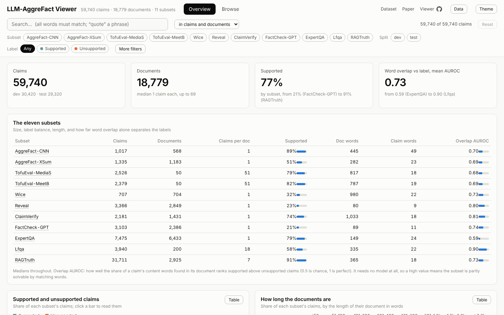
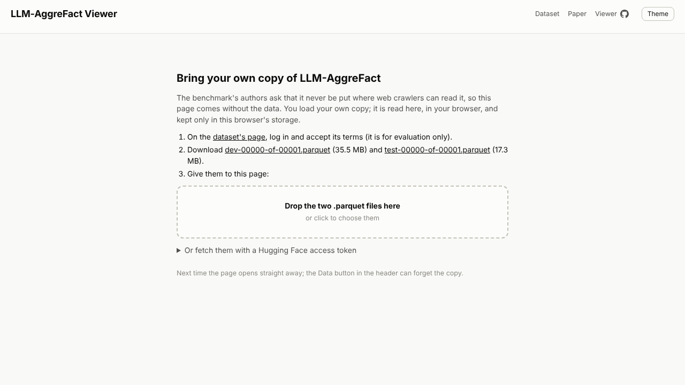
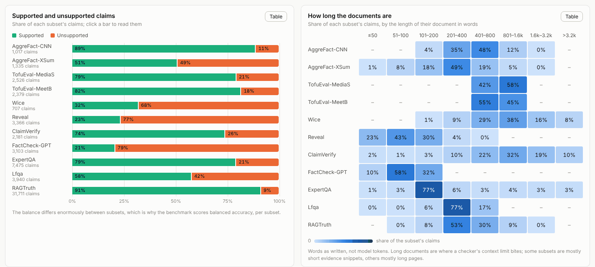
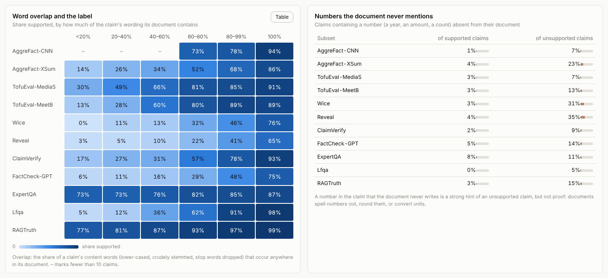
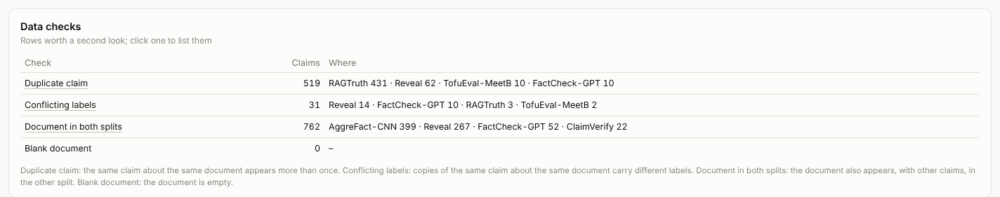
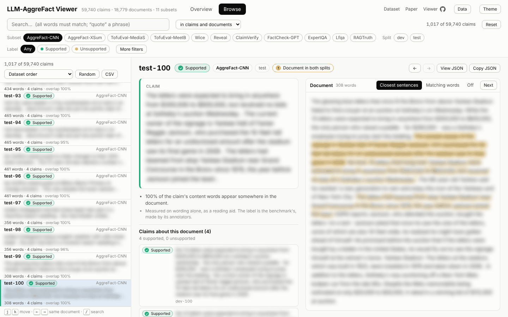
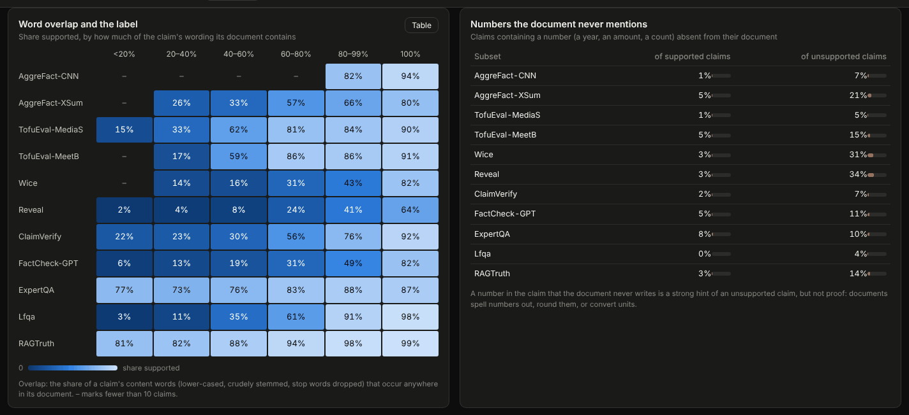

# LLM-AggreFact Viewer

A tool for exploring [LLM-AggreFact](https://huggingface.co/datasets/lytang/LLM-AggreFact), the fact-checking benchmark from the [MiniCheck paper](https://arxiv.org/abs/2404.10774) and behind the [LLM-AggreFact leaderboard](https://llm-aggrefact.github.io). The benchmark has 59,740 claims, each paired with a document and labelled **supported** or **unsupported** by it. They come from eleven subsets, collected from eleven earlier datasets of news, dialogue, Wikipedia, web search and retrieval-augmented answers.

**Open it at https://pmilovanov.github.io/llm-aggrefact-viewer/**, then give it your own copy of the data. That takes about a minute and is explained [below](#getting-your-copy-in).



It runs entirely in your browser. There is no server and no account, and nothing you load is sent anywhere.

## Why the data is not here

LLM-AggreFact is released under CC BY-ND 4.0 behind a Hugging Face access form. The form asks you to agree that it is for evaluation only: *"Data in the benchmark should not be used in pretraining or fine-tuning any NLP models."* Its Reveal subset goes further. Reveal's own terms say it *"should not be uploaded to the internet where web-crawlers can access it (such as plain-text in github…)"*, and *"Please do not redistribute any part of the dataset without sufficient protection against web-crawlers."* Every row carries a contamination identifier, so that copies found in web crawls can be traced.

A copy on a public website would undo all of that. So this repository and the site contain **no rows of the benchmark**:

- **The site holds no data.** It reads a copy you provide.
- **The tests hold no data.** They run on an invented fixture. The checks against the real files compare counts and a digest, never text, because CI logs are public too.
- **The screenshots hold no data.** They show charts. In the one view of a claim, the text is blurred past reading.

## Getting your copy in

1. Log in to Hugging Face and accept the terms on [the dataset's page](https://huggingface.co/datasets/lytang/LLM-AggreFact).
2. Open the viewer and do either of these:
   - **Drop the files in.** Download [`dev-00000-of-00001.parquet`](https://huggingface.co/datasets/lytang/LLM-AggreFact/resolve/981dfd0bd8e58e7238a9ab92b2e6ea44bce918e4/data/dev-00000-of-00001.parquet?download=true) (35.5 MB) and [`test-00000-of-00001.parquet`](https://huggingface.co/datasets/lytang/LLM-AggreFact/resolve/981dfd0bd8e58e7238a9ab92b2e6ea44bce918e4/data/test-00000-of-00001.parquet?download=true) (17.3 MB), then drop them on the page or choose them. One file alone works too.
   - **Paste an access token.** A [read-only token](https://huggingface.co/settings/tokens) lets the page fetch the files itself. The token is sent to huggingface.co and nowhere else, and is not stored.



The page reads the files in a background thread, which takes five to ten seconds. It then keeps them in this browser's storage (IndexedDB), so later visits open at once. The **Data** button in the header shows where your copy came from and can delete it.

The viewer is pinned to [revision `981dfd0`](https://huggingface.co/datasets/lytang/LLM-AggreFact/tree/981dfd0bd8e58e7238a9ab92b2e6ea44bce918e4) of the dataset. A claim's id, such as `test-1234`, is its split and its row number in that revision's file. If you load other files, the Data button says so.

## What you can see

Everything follows the filter bar at the top: subset, split, label, data checks, "number not in document", and a search of claims, documents or both. The URL keeps the filters and the claim on screen, so any view can be bookmarked or shared with someone who has their own copy.

### The overview

Every chart breaks the benchmark down by subset. RAGTruth alone is 53% of the claims, so any pooled figure would mostly describe RAGTruth. The benchmark's own score is per-subset balanced accuracy, averaged.

- **The eleven subsets.** For each subset: claims, documents, claims per document, share supported, document and claim length, and an *overlap AUROC*. That last column is how well plain word overlap separates the labels. Click a subset's name to read its claims.
- **Supported and unsupported claims.** The share supported runs from 21% (FactCheck-GPT) to 91% (RAGTruth).
- **How long the documents are.** Reveal and FactCheck-GPT documents are short evidence snippets: the median is 80 and 89 words. ClaimVerify's are whole web pages, with a median of 1,033 words.



- **Word overlap and the label.** This chart takes the share of a claim's content words that appear anywhere in its document, and shows how often claims at each level of overlap are supported. No model is involved. Even so, overlap ranks supported claims above unsupported ones with an AUROC of 0.90 on Lfqa, but only 0.59 on ExpertQA. Some subsets are partly solvable by matching words; others are not.
- **Numbers the document never mentions.** This counts claims containing a year, amount or count that the document never writes. About a third of unsupported claims in Reveal (35%) and Wice (31%) have one, against 8% or fewer of supported claims in every subset.



- **Data checks.** These are rows worth a second look:
  - **Duplicates:** 519 rows repeat a claim about the same document, 431 of them in RAGTruth.
  - **Conflicting labels:** 31 of those copies disagree on the label, 14 in Reveal and 10 in FactCheck-GPT.
  - **Shared documents:** 762 rows have a document that also appears, with other claims, in the other split. 399 are in AggreFact-CNN and 267 in Reveal.

  Click a check to list its rows.



### Browse

On the left is a list of the claims that pass the filters. It can be sorted by dataset order, word overlap, document length, or the number of claims per document. On the right is one claim in full:

- **The claim and its label.** Below them: how much of its wording the document contains, and any numbers the document never mentions.
- **The document, with its closest sentences highlighted.** Up to three sentences that share the most content words with the claim are highlighted, with the shared words underlined. Switch to **Matching words** to see every shared word, or **Off** for clean text. **Next** steps through the highlights. The highlights are a reading aid computed from wording, not the annotators' evidence. The label is the benchmark's.
- **Every other claim about the same document**, with its label. A TofuEval transcript carries about 50 claims; ← and → step through them.
- **View JSON / Copy JSON.** The row exactly as stored in the file.



*(The text is blurred here, in the README, only. In the viewer it is your own copy, in full.)*

The **CSV** button exports the filtered list as ids and measurements, without text, for joining with your own copy.

### Keyboard shortcuts

`j` / `k` next / previous claim · `←` / `→` previous / next claim about the same document · `v` view JSON · `/` search · `1` / `2` Overview / Browse · `t` theme · `Esc` leave a field

Light and dark themes follow your system; `t` switches between them.



## How the measures work

- **Content words.** The text is split into words of letters and digits in any script, lower-cased, with a short list of English stop words dropped and common suffixes stripped (*repairs*, *repaired* and *repairing* all match).
- **Word overlap.** The share of the claim's distinct content words found anywhere in the document.
- **Overlap AUROC.** The chance that a random supported claim has more overlap than a random unsupported one, with ties counting half. 0.5 is chance. It is computed per subset, and only when the selection has at least ten claims of each label.
- **Numbers not in the document.** A number is digits with optional internal `,` or `.`; thousands separators are ignored, so 2,400 matches 2400. The check is a hint, not proof: documents spell numbers out, round them, and convert units.
- **Closest sentences.** Sentences are split at `.`, `!` and `?` (with titles like *Dr.* and initials excused) and at line breaks. They are ranked by how many of the claim's content words they contain.

## Running it locally

You need [Node](https://nodejs.org) 22 or later for the tests, and [uv](https://docs.astral.sh/uv/) to download the data. [just](https://github.com/casey/just) is optional; each recipe is one command, listed in the `justfile`.

```sh
just fetch-data   # needs a Hugging Face login with access: `uvx --from huggingface_hub hf auth login`, or HF_TOKEN
just run          # http://127.0.0.1:8765/
just test
```

With `site/data/` present, the page on 127.0.0.1 opens with it directly. `?data=none` skips it, for trying the drop-in screen; `?data=local` insists on it.

## Development

There is no build step. The site is plain ES modules in `site/js/`:

| File | Role |
|---|---|
| `corpus.js` | the data layer: parquet rows to a columnar index; details, search, data checks |
| `corpus.worker.js` | runs it off the main thread; finds the data (browser storage, `site/data/`, files, Hugging Face) |
| `store.js` | the IndexedDB copy |
| `data.js` | the page's side: the index, the shared filters, the URL |
| `overview.js`, `browse.js`, `detail.js`, `getdata.js` | the views |
| `lib.js` | pure helpers: words, stems, sentences, AUROC |
| `charts.js`, `ui.js` | chart primitives and DOM helpers |

Parquet is read by [hyparquet](https://github.com/hyparam/hyparquet) 1.31.5, vendored unmodified in `site/vendor/hyparquet/` without its Node-only file reader.

The tests use `node --test`:

- `tests/lib.test.mjs` and `tests/corpus.test.mjs` run on `tests/fixtures/`. That is a miniature benchmark with invented texts, written by pyarrow like the real files (`just fixture`). pyarrow's own reading of it is stored in `expected.json`, and the parquet reader must reproduce it exactly.
- `tests/real-data.test.mjs` runs when `site/data/` holds the real files. It checks a SHA-256 digest of all 59,740 rows, computed with pyarrow by `just digest`, the subset sizes and label counts, and the data-check totals, all counted independently with pyarrow. It is written so that a failure prints numbers, never text.

CI runs the tests on every push and pull request, then publishes `site/` from `main` to GitHub Pages. If the repository has an `HF_TOKEN` secret, CI also downloads the pinned files into the runner and runs the real-data checks. The files are never uploaded or deployed.

## Licence and credits

The viewer is under the [MIT License](LICENSE). hyparquet is MIT-licensed by Hyperparam (`site/vendor/hyparquet/LICENSE`).

LLM-AggreFact is by Liyan Tang, Philippe Laban and Greg Durrett, released under CC BY-ND 4.0. It aggregates AggreFact (CNN/DM and XSum), TofuEval (MediaSum and MeetingBank), WiCE, REVEAL, ClaimVerify, FactCheck-GPT, ExpertQA, LFQA and RAGTruth, each under its own terms; see the dataset card. If you use the benchmark, cite it:

```bibtex
@InProceedings{tang-etal-2024-minicheck,
  title = {MiniCheck: Efficient Fact-Checking of LLMs on Grounding Documents},
  author = {Liyan Tang and Philippe Laban and Greg Durrett},
  booktitle = {Proceedings of the 2024 Conference on Empirical Methods in Natural Language Processing},
  year = {2024},
  publisher = {Association for Computational Linguistics},
  url = {https://arxiv.org/pdf/2404.10774}
}
```
